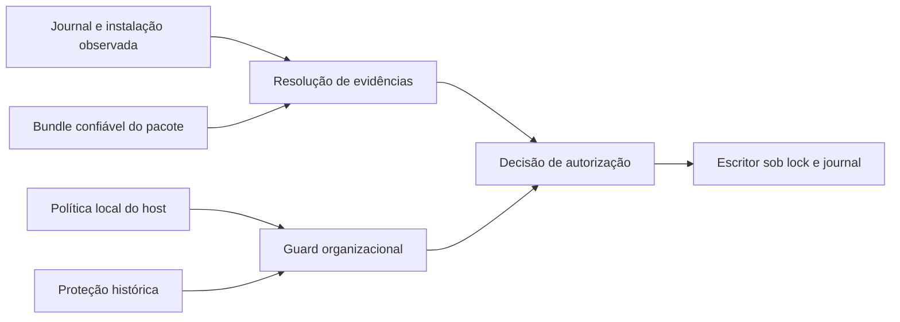

# Proveniência de instalações e proteção organizacional de skills

Status: proposta para revisão; não autoriza implementação. Preparada com
três investigações independentes de specs, código atual e autorização.
Base: main `c77c92c6272fd3858e5d43df6faa12839d79154a`, após o PR #99.

## Objetivo e entendimento

Permitir identificar uma instalação existente, explicar suas permissões e
registrar uma decisão explícita do usuário sobre instalações sem prova
anterior. Aplicar proteção organizacional antes das mutações disponíveis.
Preservar snapshots, histórico, restauração, tombstones e catálogos de turnos
iniciados. A investigação e a preparação do design foram autorizadas; as
regras novas deste documento ainda precisam de aprovação.

A recomendação para legado é adoção explícita, com confirmação e revogação,
sem alegar que o usuário escreveu os arquivos anteriormente. Essa escolha
foi apresentada à usuária separadamente e permanece uma proposta neste
documento. Identificação sozinha nunca concede autorização.

Não entregar download/busca/update pelo hub, administração de organizações,
pull de mirrors, edição por modelo, `/learn` ou curadoria automática neste
recorte. Integrar o escritor de promoção já público não equivale a entregar
um novo fluxo de aquisição. Não acrescentar ferramenta ao core.

## Rastreabilidade e limites das fontes

As fontes Reversa ficam em `../hermes-agent/_reversa_sdd/`, relativo à raiz
do repositório principal. `source_ref`, `unit` e `enforced_at` continuam nas
fontes; comentários novos de produto não substituem essa rastreabilidade.

| Fonte | Contrato herdado |
|---|---|
| `adrs/009-proveniencia-de-skill.md`, Decisão e Alternativas | Origem nasce no ato de escrita; frontmatter não escolhe propriedade; somente o fork background_review cria material auto-curável |
| `skills/requirements.md`, RF-04 e regras de propriedade | Foreground pertence ao usuário; ausência de proveniência não autoriza curadoria |
| `skills/tasks.md`, T-04 e TT-04/05/06 | Contexto de escrita explícito e teste por superfície; não generalizar cron/subagente como autoria autônoma |
| `domain.md`, §2.3; `permissions.md`, §3.2/3.4 | Atores autônomos nunca fazem hard-delete; foreground ainda precisa passar pelos demais guards |
| `skills/requirements.md`, portões e segurança; `skills/design.md`, matriz e fluxos alternativos | Proteção organizacional cobre delete/remove_file; não há exigência de proibir toda edição |
| `skills/design.md`, HubLockFile; `skills/tasks.md`, T-27/TT-20/TM-05 | Origem de distribuição rastreável; quarentena obrigatória; hub não é ferramenta do agente |
| `docs/decisoes.md`, D-09.SYNC e D-09.1–D-09.7 | Diretório completo, edição/exclusão local preservadas, author privado, manifesto MD5 sem autoridade de segurança |
| D-CLI.SKILL.AUTHOR e D-CLI.SKILL.REMOVE | SQLite canônico, identidade observada, recuperação conservadora; guard org geral ainda pendente |
| Specs de autoria, catálogo e remoção aprovadas | IDs/blobs anteriores imutáveis; restore conserva origem; rollback antigo não alcança instalação posterior |

As specs não definem enrollment organizacional, emissor, formato de política,
administradores ou override. A política local descrita abaixo é uma decisão
nova proposta para Kairos, não uma regra que já constava do Reversa. Seu
escopo é restrição local; não autentica uma organização ou um distribuidor.

Resolver duas inconsistências das fontes conservadoramente: ausência de
contexto permanece protegida, enquanto classificação autônoma indevida é
erro; a matriz explícita ação×portão prevalece sobre a contagem textual de
quatro gates para delete, pois frontmatter de nova criação só cabe a create.

## Situação atual

O journal comprova create USER e restore USER/BUNDLED por identidade corrente.
Uma instalação fora do journal só pode ser removida quando corresponde à
árvore completa do bundle atual do pacote e ao manifesto v2 íntegro.

`ownership(name)` usa USER como fallback protetivo de curadoria. Remove
deliberadamente não usa esse fallback como prova. Hub é canal de aquisição,
não classe de proprietário; seus dados de source/trust são transitórios.
A promoção pública ainda faz substituição sem o lock/journal compartilhado.
Sync já compartilha lock e tombstones, mas uma publicação legítima pode trocar
inode sem atualizar a instalação comprovada. O próximo design precisa
coordenar esses escritores, não somente acrescentar um campo origin.

## Alternativas e recomendação

1. **Identificação somente leitura.** Explica as recusas existentes e tem
   alcance pequeno, mas não permite administrar legado nem corrige a perda
   de prova após publicação legítima.
2. **Registro de instalação, adoção explícita e política independente.**
   Recomendado: separa fatos e decisões, liga autoridade à identidade observada
   e integra escritores atuais. Exige journal de publicações e recuperação.
3. **Hub e administração organizacional completos.** Pode gerar novas provas
   de aquisição, mas adiciona autenticação, redes, atualização e revogação
   remotas. Depende desta fundação e fica para outro recorte.

## Três dimensões independentes

| Dimensão | Significado | O que não comprova |
|---|---|---|
| Autoria histórica | Ato de criação comprovado, ou desconhecida | Adoção posterior não prova autoria anterior |
| Fonte da instalação | Local, bundle do pacote, quarentena com recibo, ou desconhecida | URL, trust_level ou manifesto isolados não conferem propriedade |
| Autoridade/proteção atual | Permissão fundada em escrita comprovada ou adoção, mais vetos organizacionais | Foreground não dispensa veto; USER por default não é permissão |

Manter `Provenance.USER/BUNDLED/SEDIMENT` com seu significado de propriedade
e elegibilidade à curadoria. Não acrescentar HUB como proprietário nem usar
USER para ocultar origem histórica desconhecida. O resultado da resolução
expõe separadamente esses campos e a base da autorização.



## Autoridade da proteção organizacional

Propor política local versionada, configurada na composição administrativa
do host e lida por descritores. Seu caminho não vem de argumento da ferramenta,
frontmatter, source do hub ou conteúdo do modelo. Deve ficar fora do home e
dos workspaces graváveis pelo runtime; arquivo e cadeia precisam ser
inacessíveis à escrita do usuário de execução ou estar em mount somente
leitura atestado. Configuração incompatível/indisponível recusa mutações.
Não considerar pathname convencional uma prova dessa separação.

A configuração que seleciona a política, inclusive a decisão de não usar
uma, integra essa mesma fronteira administrativa. Não permitir que argumento
CLI, variável de ambiente gravável pelo modelo ou config do home desabilite,
redirecione ou substitua uma política configurada. A composição administrativa
deve atestar também sua própria configuração; atestar só o arquivo escolhido
não basta. Um chamador de biblioteca sem composição confiável recusa escrita.

A política reserva nomes planos por home canônico e organização. Um nome
igual em outro home não recebe veto por coincidência. Seu formato tem versão,
identificação da política, bindings de home e entradas únicas com nome e
organization_id; rejeitar duplicatas, caminhos externos e coerções de tipo.
IDs organizacionais são rótulos administrativos, não credenciais verificadas.

Também reservar conservadoramente `skills/_org/` para mirrors. Essa convenção
é proposta Kairos; as specs apenas exigem o veto de mirrors. Não implementar
consumo ou pull desse namespace agora. Organização ativa/inativa e presença
de sidecar não controlam o veto; symlink/mount nunca serve de autorização.

Proteção já comprovada nos registros de uma instalação fica registrada de
forma durável e não desaparece porque a política perdeu uma entrada, o marcador
mudou ou o arquivo ficou indisponível. Revogação dessa proteção exige futuro
contrato administrativo; não oferecer bypass, unprotect ou force nesta fase.
Uma publicação autorizada conserva fatos de proteção herdados; identificar
ou recusar uma operação não acrescenta um registro de instalação. Um reader
não registra observações. Um escritor captura política e histórico
sob lock, atesta novamente a fonte antes de cada efeito e recusa divergência.

Não oferecer defesa contra administrador que reescreve código, banco e todas
as provas, nem detecção de cópias arbitrárias de conteúdo organizacional em
outra instalação. A fronteira protege o namespace e os bindings conhecidos,
sem classificar conteúdo por heurística. A configuração opcional ausente
significa que não há bindings externos configurados; vetos do namespace e do
histórico continuam obrigatórios. Fonte configurada e ausente é erro.

## Interface e efeitos propostos

```bash
kairos skills identify NOME --json
kairos skills adopt NOME --yes --json
kairos skills unadopt ID_DA_ADOCAO --yes --json
```

`identify` consulta a instalação, provas existentes e política. Não cria home,
banco, lock, migração, capability SQL escritora ou sidecars no home. Reutiliza
a cópia privada estável DB+WAL da leitura entregue. Retorna autoria histórica,
fonte, base de autorização, proteção, validade da identidade e motivos; não
imprime conteúdo, credenciais ou caminho externo da política. A identificação
de estado desconhecido é diagnóstico válido com `removivel=false`; corrupção
ou impossibilidade de atestação são erros, não origem desconhecida normal.

`adopt` exige USER_FOREGROUND e confirmação antes de qualquer I/O. Registra
um novo ato: o usuário assume a administração local daquela instalação.
Autoria histórica e fonte permanecem desconhecidas quando faltam provas.
Nunca fabrica create, concede SEDIMENT ou reclassifica um mirror protegido.
A árvore deve ser regular, estável e atender aos limites de remoção; não
exigir semver para SKILL.md legado. Registro liga home, identidade da raiz,
inventário completo e snapshot aos bytes observados.

Após committed, a adoção autoriza remove daquela identidade, com propriedade
USER por decisão atual e base explícita `user_adoption`. Edições internas não
inventam autoria histórica nem mudam essa base; substituição da raiz invalida
autoridade, mesmo byte-idêntica. Não transferir uma propriedade BUNDLED já
comprovada para USER por adoção. Para uma instalação já comprovada e vigente,
não criar outro registro ativador: informar a prova existente e conservar ID.

Repetir a mesma adoção concluída retorna seu ID quando a identidade e a
projeção continuam vigentes. Uma instalação posterior exige decisão nova.
Não aceitar `--origin`, `--actor`, `--force` ou fonte histórica fornecida pelo
modelo como forma de escolher proprietário ou afastar proteção.

`unadopt` revoga somente a autoridade de uma adoção ainda corrente. Exige
foreground, confirmação, ausência de pendências e identidade correspondente.
Registra outro ID e preserva integralmente arquivos, modos, snapshot e provas.
Depois, remove volta a exigir prova positiva; o fallback protetivo da curadoria
continua. Restore de uma instalação adotada conserva também o ID da adoção
fundadora: `unadopt` desse ID pode revogar a autoridade da identidade corrente
derivada, após verificá-la. Não altera o evento RESTORE nem seus arquivos.
Não revoga create/restore com autoridade independente, uma adoção nova ou
instalação substituída fora dessa linhagem. Recusa quando a linhagem não estiver
presente ou sua identidade corrente divergir; nunca agenda veto retroativo.
Uma nova adoção explícita pode conceder nova autoridade. Rollback dos IDs de
adoção/revogação é recusado com explicação; sua reversão administrativa tem
este comando próprio, distinto da reversão de arquivos existente.

## Escritores e publicações

Toda operação decide sobre destino e política na camada de serviço, inclusive
chamadas diretas à biblioteca; guards só no parser CLI não bastam.

| Escritor atual | Integração necessária |
|---|---|
| Add | Conserva create USER e seu ID; verifica reserva/proteção antes de preparar/publicar |
| Remove | Aceita prova vigente de escrita ou adoção; captura bytes atuais; veto organizacional precede retirada |
| Rollback de create | Reavalia proteção corrente e ID antes de retirar; prova antiga não vence política nova |
| Restore de remove | Conserva propriedade, fonte e base histórica; recusa reserva/destino ocupado; publica identidade nova |
| Sync bundled | Mantém política de edição/exclusão; registra identidade de cada publicação autorizada sem inferir USER |
| Promoção de quarentena | Exige contexto de escrita, guard, lock e publicação comprovada; destino ocupado não é apagado diretamente |

Sync da raiz do pacote pode comprovar fonte BUNDLED pelo inventário completo.
Sync de raiz arbitrária não ganha essa autoridade por usar a mesma função:
registra fonte externa/desconhecida, sem autoria foreground ou autorização
destrutiva implícitas. Toda substituição real cria ID de instalação novo;
atualização meramente administrativa de metadados não muda ID corrente.

O contexto de um escritor interno não é um argumento de origem livre: a
composição do sync atesta a raiz do pacote; autoria manual fixa foreground;
promoção sem chamador identificado recusa. A API antiga de promoção deve
falhar explicitamente se não puder estabelecer esse contexto. Uma fonte
declarada no bundle pode ser informação de aquisição, nunca prova de USER,
BUNDLED ou organização. Não persistir URL com segredo, query ou userinfo.

Atualização exige instalação anterior ainda íntegra para a política de sync,
ausência de vetos e publicação por descritores. Guard organizacional bloqueia
troca destrutiva do destino materializado pelos escritores deste recorte.
Isso não declara que toda edição in-place é proibida: edit/patch/write_file
continuam fora da interface entregue e precisam de contrato próprio.

## Persistência, projeção e recuperação

Acrescentar família de registros de instalação/adoção/revogação ao SQLite
canônico. Guardar provas e snapshots imutáveis; não reescrever eventos,
conteúdos, IDs ou origem dos journals antigos. O plano detalhará a migração
aditiva, constraints e integração da timeline; tabelas canônicas entram em
backup/reparo e a capability escritora sobe junto ao contrato novo.

A projeção comum distingue instalação presente, autoridade vigente, proteção
e exclusão de sync. CREATE, RESTORE e publicação nova ativam identidades;
ADOPT só passa a conferir autoridade à instalação observada antes sem prova.
UNADOPT revoga essa autoridade sem retirar a instalação. Get/history/pending
leem todas as famílias, pela sequência global, sem depender de timestamps.

Ausência/partialidade de registro não cria autorização. Clientes antigos
recusam schema/capability incompatível antes de tocar arquivos. Catálogos
existentes e assets de turnos já iniciados permanecem imutáveis; identificação
administrativa não acrescenta custo ao prompt nem exige tool nova.

Adoção prepara snapshot e prova duravelmente, reconfere árvore/política e só
então conclui. Recuperação com instalação íntegra e autorização corrente
revalidada conclui; veto organizacional superveniente aborta a adoção sem
alterar arquivos, enquanto política indisponível preserva a pendência e recusa
recuperação até que possa ser atestada. Instalação ausente
aborta sem reconstruí-la; instalação divergente gera conflito preservando
provas. Revogação é transação de journal, sem mutação de arquivos. Pendências
de qualquer família bloqueiam todos os escritores sob o lock comum.

Publicação registra snapshot/provas antes de movimentar a árvore: original
e staging esperados permitem abortar preservando original; destino novo com
prova íntegra e original privado esperado permite concluir; divergência,
ambos inesperados ou provas insuficientes preservam versões e geram conflito.
Aplicar os seguintes estados observados, sempre com provas duráveis e política
válida reconferidas:

| Publicação | Estado observado | Recuperação |
|---|---|---|
| Inicial | Destino ausente, staging esperado | Abortar; preservar destino ausente e limpar somente staging comprovado |
| Inicial | Destino contém identidade nova esperada, staging ausente | Concluir publicação |
| Substituição | Original esperado no destino, staging novo esperado | Abortar sem alterar original |
| Substituição | Destino ausente, original privado esperado e staging novo esperado | Restaurar original e abortar |
| Substituição | Destino novo esperado, original privado esperado e staging ausente | Concluir publicação; conservar snapshot do original |
| Ambas | Identidade divergente, duplicada ou prova incompleta | Conflito; preservar versões e bloquear escritores |

Se a política passar a vetar um destino já publicado antes de commit, não
concluir nem retirar automaticamente a árvore protegida: registrar conflito.
O plano detalhará apenas a implementação desses estados e testes de morte em
cada fronteira. Órfãos desconhecidos não são adotados nem apagados por recuperação.

Tombstones existentes mantêm seu significado e não terminam por adoção,
revogação ou publicação manual. Como decisão nova, remoções futuras também
registram intenção local de exclusão do sync independentemente do proprietário:
uma skill adotada sem origem comprovada não deve reaparecer se o bundle passar
a oferecer seu nome. Restore committed encerra a exclusão vinculada; nenhuma
reclassificação histórica é necessária. Não adicionar retroativamente exclusões
a remoções USER antigas que não as registraram.

## Diagnóstico e códigos de saída

Conservar 2 para uso/nome inválido; 77 para ator/confirmação negados; 69 para
primitiva/autoridade atestável indisponível; 1 para conflito, corrupção,
ausência do alvo ou falha operacional. Política válida que proíbe a operação
é autorização negada, com motivo organizacional sanitizado. Origem desconhecida
sem adoção não é erro de sintaxe. Readers não transformam dados corruptos em
diagnóstico normal. Sucesso de escrita exige efeito real e prova committed.

JSON de adoção inclui operation_id, action, state, ownership,
historical_creation_origin, installation_source e authorization_basis.
Revogação informa seu ID, ID revogado e `authority_revoked=true` somente após
commit. Mantém metadata antiga de create/remove/restore compatível, acrescentando
campos explicativos sem mudar o significado dos registros já existentes.

## Aceitação por comportamento

- Identificar legado não registra USER comprovado; frontmatter/source/trust
  declarados não concedem autoridade. Unknown continua protegido da curadoria.
- Adoção confirmada preserva bytes/modos, tem ID real e autoriza somente aquela
  identidade; sem confirmação não cria home/lock/banco. Revogação volta a
  bloquear remoção sem retirar arquivos; nenhuma delas concede SEDIMENT.
- Mirror ativo/inativo e binding externo recusam mutação; sidecar/marcador
  ausente não libera. Política configurada indisponível/corrupta recusa;
  mesma skill pessoal em outro home não é bloqueada apenas pelo nome.
- Chamada direta a cada escritor passa pelos guards. Promoção não sobrescreve
  destino ocupado; alteração de política durante staging recusa publicação.
- Sync legítimo registra a identidade nova; remove funciona após atualização
  comprovada; substituição externa byte-idêntica recusa. Root arbitrária nunca
  comprova bundle do pacote.
- Restore conserva propriedade e fonte, verifica proteção atual e não apaga
  tombstone em falha. Adoção de bundled editada não apaga histórico ou exclusão;
  remoção adotada não é ressuscitada pelo sync.
- Pendências cruzadas bloqueiam escritores. SIGKILL e falhas de fsync nas
  fronteiras de adoção/publicação exercitam reconciliação real; snapshots e
  versões divergentes são preservados. Veto surgido após prepared impede
  commit autorizador na recuperação; fonte indisponível mantém a pendência.
- Restore de adotada conserva a linhagem revogável; unadopt verifica a
  identidade derivada corrente, não alcança criação ou adoção independente
  e não altera o snapshot nem os arquivos restaurados.
- Readers preservam DB/WAL do home, não migram nem registram escritor; versões
  antigas/modernas parciais e clientes incompatíveis recusam com diagnóstico.
- IDs/blobs/metadata antigos e snapshots de catálogo mantêm contratos; backup
  restaura banco, BLOBs, registros e volume com hashes/integridade verificados.

## Limite da conclusão e próxima etapa

Esse recorte conclui resolução/adoção e guards dos escritores atuais com uma
autoridade local definida. Não declara pronto o T-04 em todas as superfícies
futuras nem toda a matriz de skill_manage: ainda faltam as ações e contextos
de escrita por modelo. Não chama uma proteção local de autenticação remota
organizacional. A implementação do hub completo deve produzir recibos de
aquisição verificáveis por esse contrato, sem ampliar propriedade por rótulo.

Após revisão e aprovação desta spec, escrever plano de implementação com
propriedade de arquivos por agente, revisão independente e gates integrais
do projeto. A execução multiagente já foi escolhida pela usuária; aprovação
da spec não autoriza pular a revisão do plano. Nenhuma mutação de produção ou
adoção em lote é autorizada por este documento de design.
